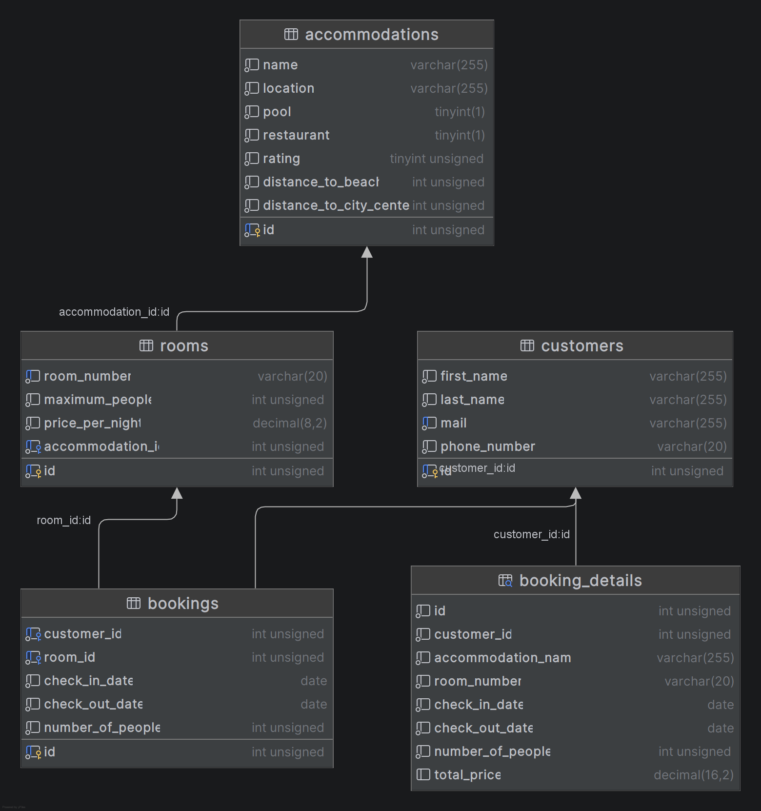

# Holiday Maker

Konsolprogram för en resebyrå där en handläggare kan registrera kunder, söka lediga rum, boka, visa, ändra och avboka bokningar. Data lagras i en MySQL-databas och programmet är skrivet i C# med MySqlConnector.

## Kom igång

1. **Skapa databasen.** Kör hela `Holiday-Maker.sql` mot din MySQL-server. Skriptet skapar databasen `holiday_maker`, tabellerna, vyn `booking_details` och testdata. Det tar bort befintliga tabeller först, så det kan köras om för att återställa testdatan.
2. **Anpassa anslutningen.** Ändra konstanterna överst i `Database.cs` så att de stämmer med din MySQL-installation:
   ```csharp
   private const string ServerName = "localhost";
   private const string DatabaseName = "holiday_maker";
   private const string UserId = "root";
   private const string Password = "...";
   ```
3. **Starta programmet** från projektmappen:
   ```
   dotnet run
   ```
   NuGet-paketet MySqlConnector hämtas automatiskt vid första körningen.

## Användning

```
1. Registrera kund
2. Välj kund
3. Sök och boka rum
4. Visa bokningar
5. Ändra antal personer
6. Avboka
0. Avsluta
```

Välj eller registrera en kund först, de övriga valen gäller den valda kunden.

- **Sök och boka:** ange ort, datum (format `2026-12-13`) och antal personer. Valfria filter: pool, restaurang, max avstånd till strand och centrum (lämna tomt för att hoppa över). Sortera på pris (lägst först) eller betyg (högst först). Välj sedan ett rum i listan för att boka. Bekräftelsen visar bokningsnummer och totalpris.
- **Visa bokningar:** listar kundens bokningar med datum, antal nätter, antal personer och totalpris.
- **Ändra antal personer:** nekas om det nya antalet inte får plats i rummet.
- **Avboka:** en kund kan bara avboka sina egna bokningar.

### Bokningsregler

- Check-out måste vara efter check-in.
- Check-out-dagen räknas inte som upptagen, så ett rum kan bokas samma dag som en annan gäst checkar ut.
- Ett rum kan inte dubbelbokas. Tillgängligheten kontrolleras igen när bokningen sparas.
- Antal personer får inte överstiga rummets maxkapacitet.

## Datamodell



| Relation | Typ |
|---|---|
| accommodations → rooms | 1 – N (ett boende har flera rum) |
| rooms → bookings | 1 – N (ett rum kan ha flera bokningar över tid) |
| customers → bookings | 1 – N (en kund kan ha flera bokningar) |

`booking_details` är en **vy**, inte en tabell. Den slår ihop bokning, rum och boende och räknar ut totalpriset (antal nätter × pris per natt). Totalpriset lagras alltså inte, eftersom det kan härledas.

## Projektstruktur

```
Program.cs              Startpunkt, kopplar upp mot databasen och startar menyn
Database.cs             Anslutningssträng och öppning av anslutning
Console_ui.cs           Meny, inmatning och utskrifter
Models/                 Dataklasser: Customer, AvailableRoom, Booking
Repositories/           All SQL, en klass per område
  CustomerRepository.cs   Hämta och skapa kunder
  RoomRepository.cs       Sök lediga rum med filter och sortering
  BookingRepository.cs    Skapa, visa, ändra och avboka bokningar
Holiday-Maker.sql       Databasschema, vy och testdata
```

All SQL använder parametrar (`@namn`) för att skydda mot SQL-injektion. Sökning, filtrering och sortering görs i SQL, inte i C#.

## Testdata

Skriptet innehåller 6 kunder, 7 boenden på 3 orter (Malaga, Alcudia, Chania), 24 rum med kapacitet 1–6 och 29 bokningar, de flesta i december 2026. Förberedda testfall finns beskrivna som kommentar i `Holiday-Maker.sql`.
